

🇬🇧 [English](README.md) | 🇸🇦 **العربية**

# أتمتة خطط التدريب

**يدفع المتدرب، فتصله خطة تدريب مخصصة.**
الذكاء الاصطناعي يكتبها، والمدرب يعتمدها مرتين، والمتدرب يستلمها بصيغة PDF بهوية العلامة.

صُمّم لـ **موصبري | Mosabri**، مدرب جري أونلاين.

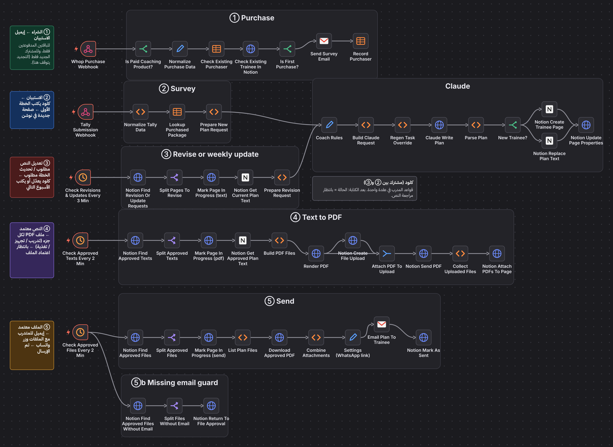

## المشكلة

مدرب جري أونلاين يبيع خططًا لعدد متزايد من المتدربين. كل خطة تعني: التحقق من الدفع، ملاحقة الاستبيان، كتابة الخطة، تصميم ملف PDF، إرساله بالبريد، وتذكّر أين وصل كل متدرب. كل ذلك يدويًا.

## الحل

مسار واحد من الدفع إلى البريد. يكتب Claude كل خطة من إجابات المتدرب وقواعد المدرب نفسه. يعدّلها المدرب في Notion، يعتمد النص، ثم يعتمد الملف المُنشأ. وبعدها فقط تُرسل.

## كيف يعمل

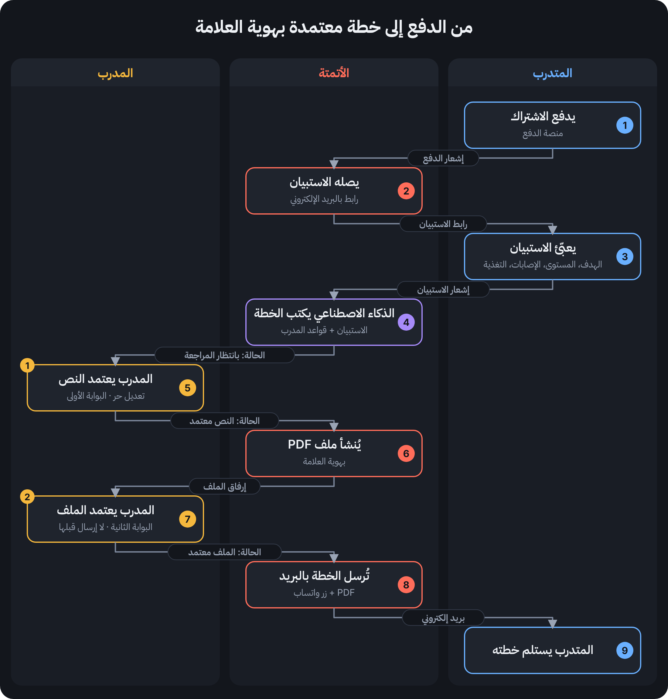

المدرب لا يغادر Notion. كل خطة صف، و**حالته** هي التي تحرّك المسار، والجدولة تلتقط أي تغيير في الحالة خلال دقائق.

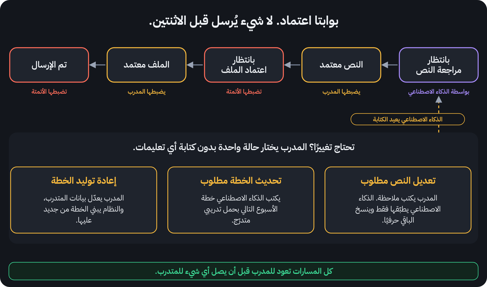

## أبرز المزايا

### الاستقبال يعمل وحده
إشعار الدفع يفلتر الباقات المدفوعة والمشتركين الجدد، ثم يرسل الاستبيان بالبريد. وإجابات الاستبيان تتحول إلى طلب خطة وصفحة جديدة في Notion.

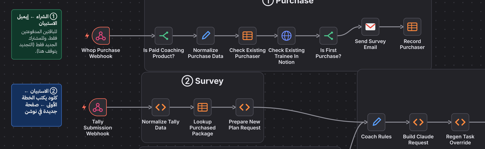

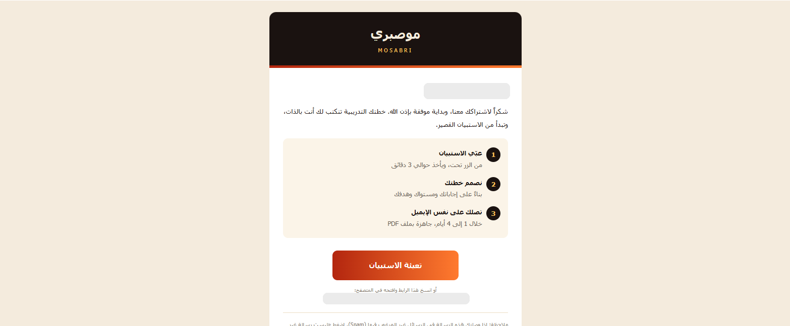

### أربع طرق لكتابة الخطة
جديدة (من الاستبيان)، **تعديل** (يطبّق ملاحظة المدرب فقط وينسخ الباقي حرفيًا)، **تحديث أسبوعي** (حمل متدرّج)، و**إعادة توليد** (من بيانات المتدرب بعد تعديلها). وكتلة واحدة مشتركة تحمل قواعد المدرب.

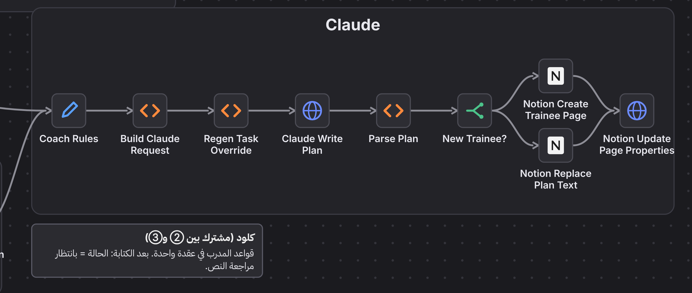

### ما يعتمده المدرب هو ما يُرسل
يُعاد بناء الـ PDF من النص المعتمد، ملف لكل جزء (تدريب، تجهيز، تغذية). فلا يضيع أي تعديل متأخر.

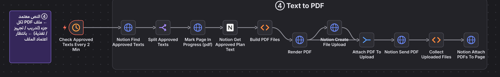

### بوابتان وحماية من الأعطال الصامتة
لا شيء يصل المتدرب قبل الاعتمادين. غياب البريد يعيد الملف للاعتماد، وحالة «جاري التنفيذ» تمنع المعالجة المزدوجة، وتنبيهات الأخطاء والبنية التحتية والتوقف تصل المدرب بالبريد.

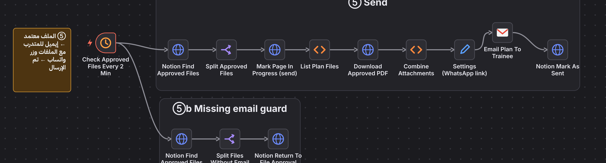

### لا يتوقف بصمت
مراقب خارجي يفحص النظام كل 5 دقائق ويرسل بريدًا للفريق لحظة توقفه عن الاستجابة.

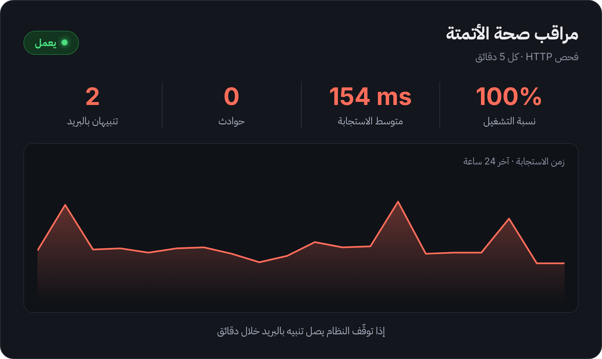

### قواعد أمان مدمجة
لا تشخيص للإصابات، وأي حساسية غذائية تُستبعد، والمبتدئ يحصل على برنامج جري ومشي بدل خطة سباق.

## التقنيات والأدوات

| الطبقة | الأداة |
|---|---|
| التنسيق | n8n مستضاف ذاتيًا |
| الذكاء الاصطناعي | Claude API Key |
| الدفع | Whop webhooks |
| الاستبيان | Tally |
| مساحة العمل وقاعدة البيانات | Notion |
| ملف PDF | Gotenberg + مصمّم شرائح مخصص |
| البريد | Gmail |
| الاستضافة | Railway (n8n وPostgres وخدمات التصميم) |
| المراقبة | UptimeRobot + مسار تنبيه الأخطاء في n8n |

## النتائج

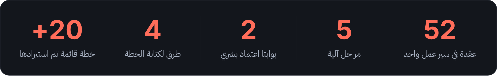

الشراء ← الاستبيان ← الخطة ← PDF ← البريد، تم التحقق منه من البداية للنهاية لمتدرب جديد ومتدرب سابق. ولا خطة تُرسل بدون الاعتمادين بحكم التصميم.

**لوحة المدرب في Notion**

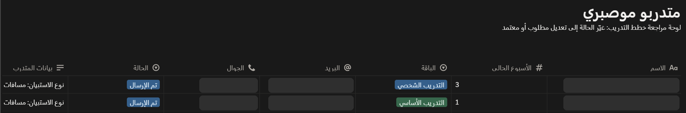

**خطة كتبها الذكاء الاصطناعي مع تفسير قراراته، وجاهزة للتعديل**

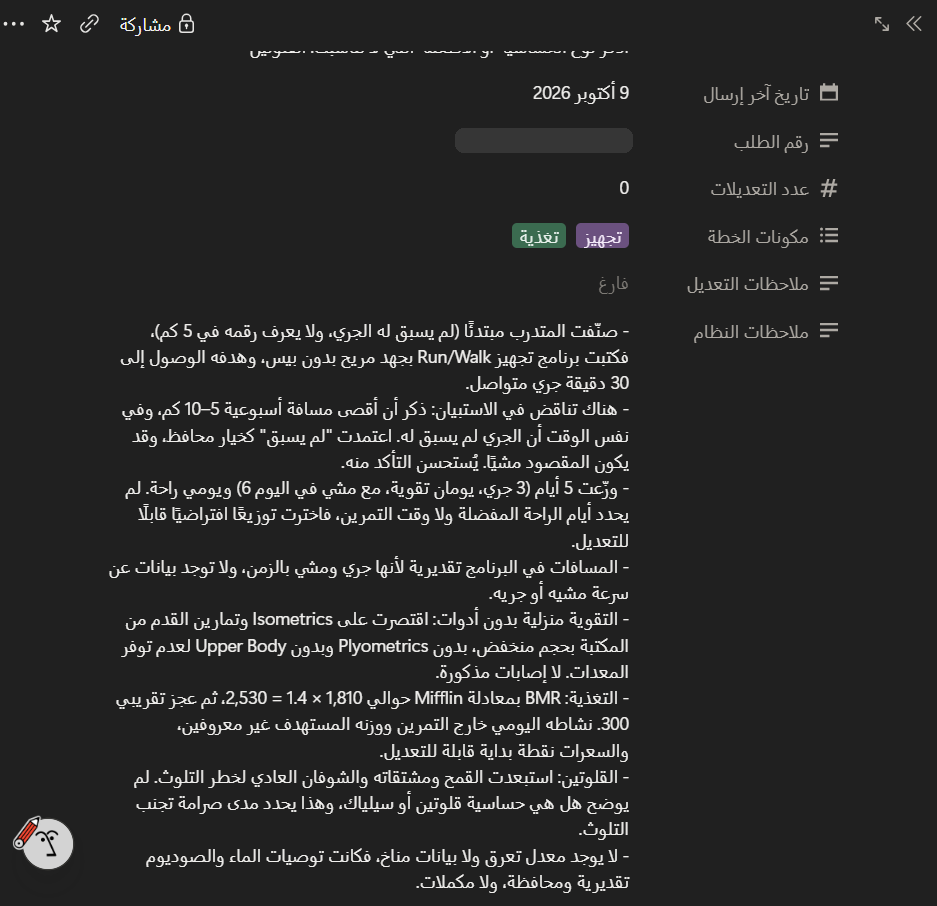

**ما يستلمه المتدرب**

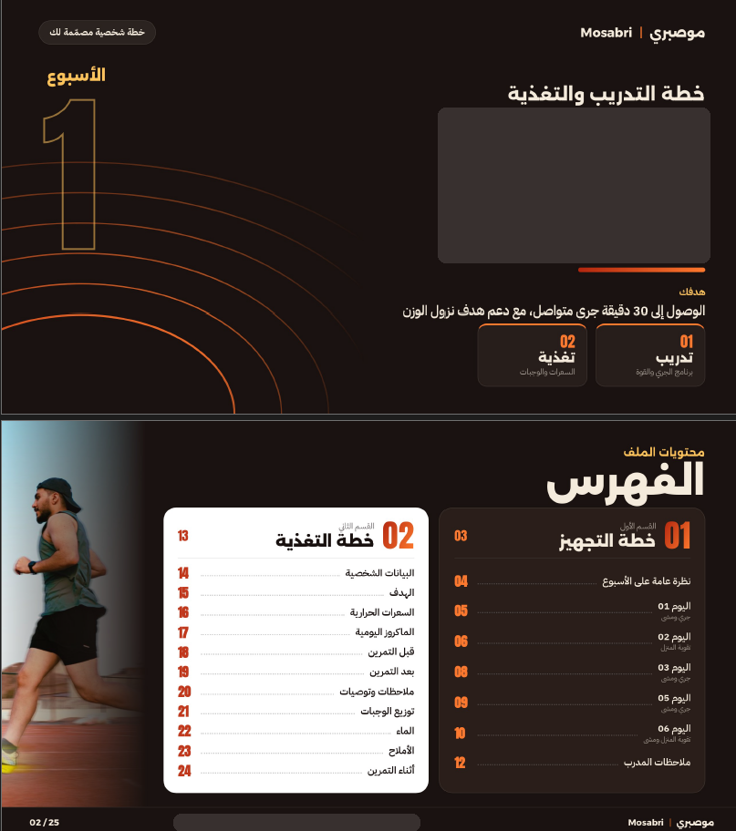
  
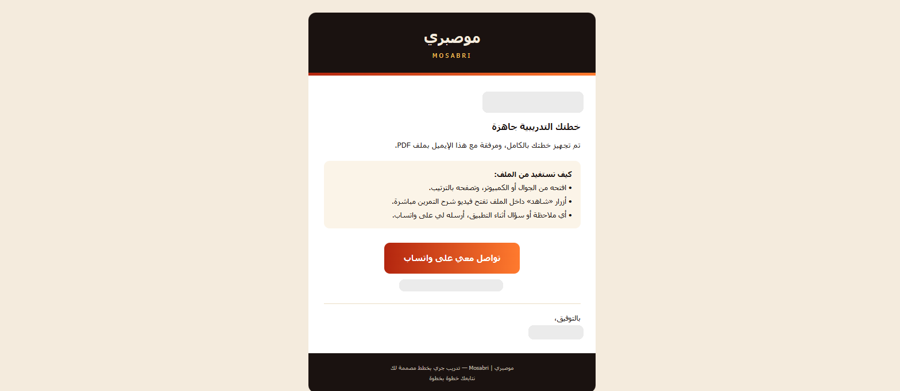

الخطط مكتوبة بالعربية. أسماء المتدربين وبيانات التواصل وبيانات الدخول مُخفاة أو مستبعدة.

