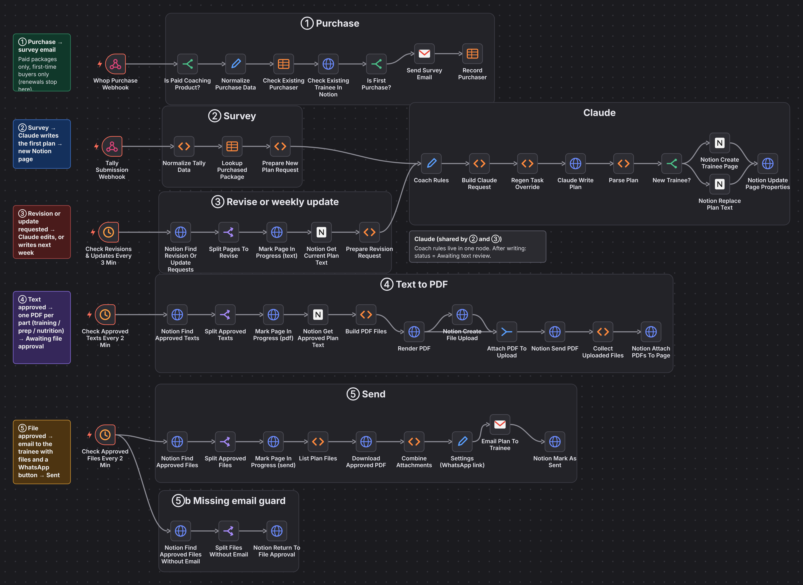
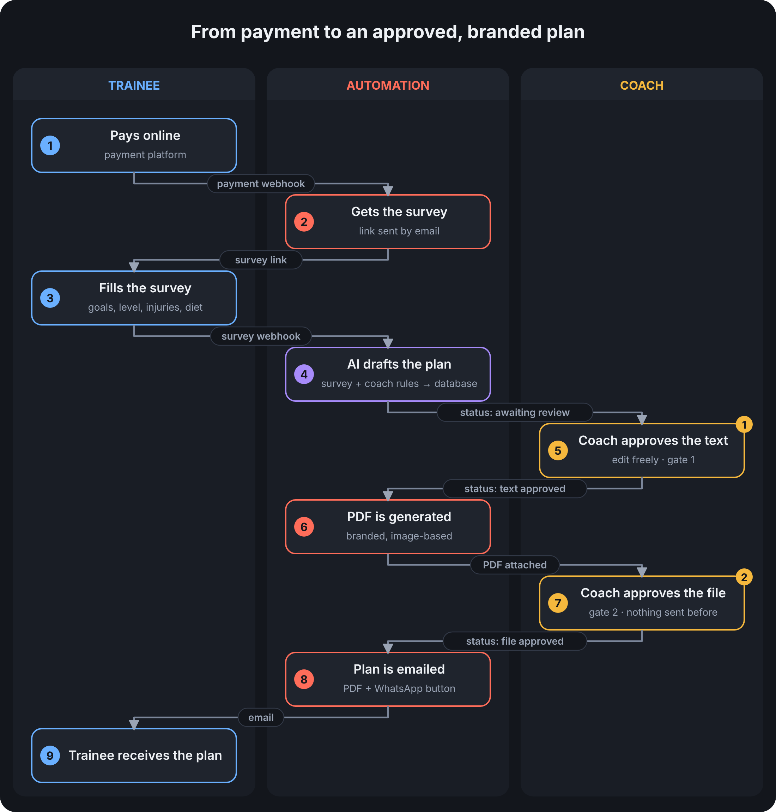
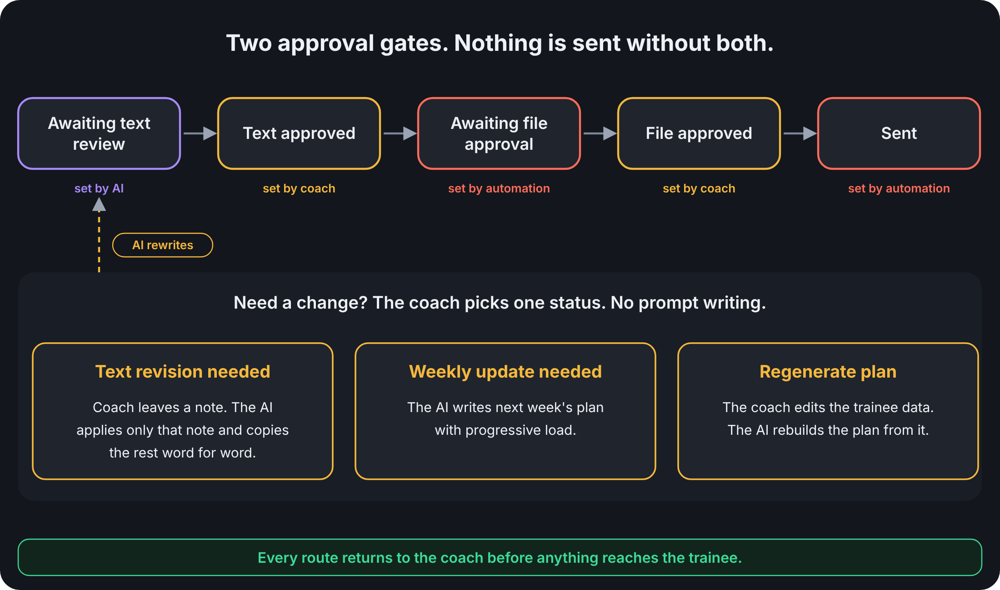
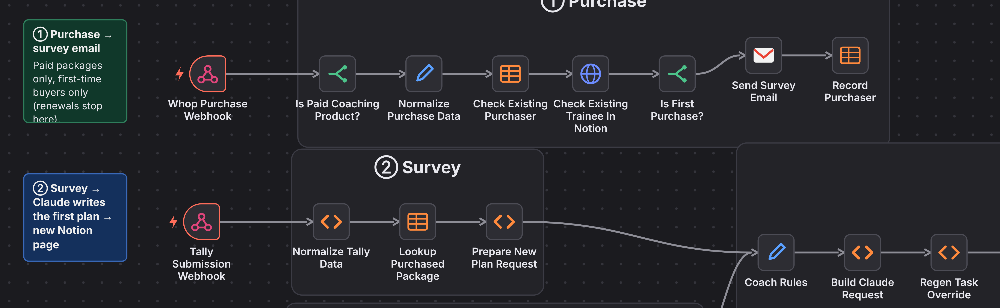
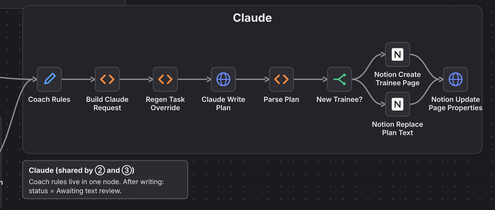
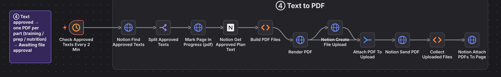
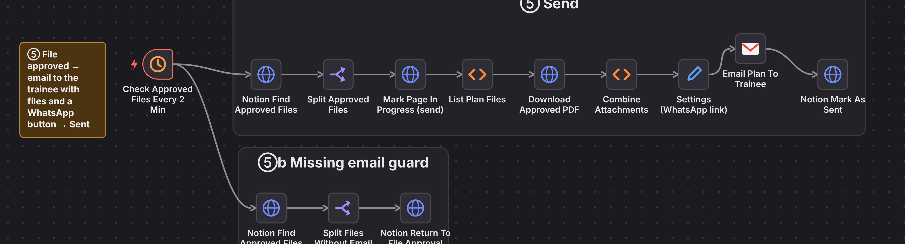
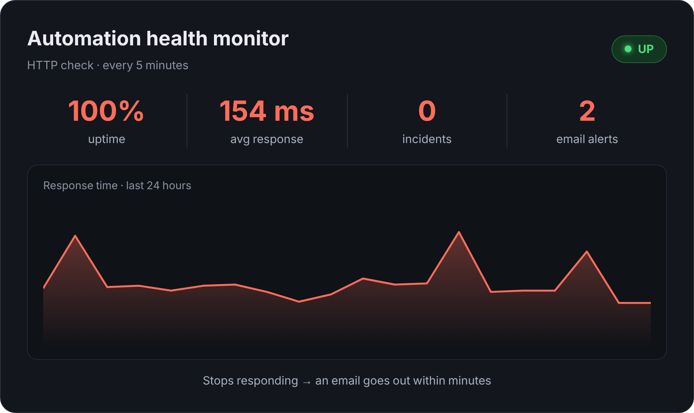
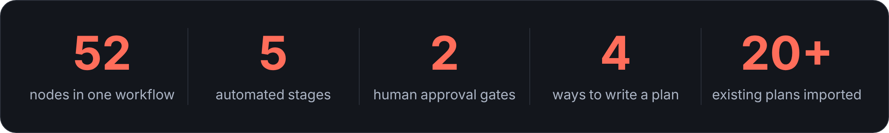

🇬🇧 **English** | 🇸🇦 [العربية](README.ar.md)

# Coaching Plan Automation

**Payment in, personalised training plan out.**
AI drafts it, the coach approves it twice, the trainee gets a branded PDF.

Built for **Mosabri | موصبري**, an online running coach.

## The Problem

An online running coach was selling plans to a growing number of trainees. Every plan meant checking the payment, chasing the questionnaire, writing the plan, designing a PDF, emailing it and remembering who is on which week. All by hand.

## The Solution

One pipeline from payment to inbox. Claude drafts each plan from the trainee's answers and the coach's own rules. The coach edits it in Notion, approves the text, then approves the generated PDF. Only then does it send.

## How It Works

The coach never leaves Notion. Each plan is a row whose **status** drives the pipeline, and schedulers pick up every status change within minutes.

## Key Features

### Intake runs itself
A payment webhook filters paid packages and first-time buyers, then emails the survey. The survey answers become a new plan request and a new Notion page.

### Four ways to write a plan
New (from the survey), **revise** (applies only the coach's note and copies the rest word for word), **weekly update** (progressive load) and **regenerate** (rebuilds from edited trainee data). One shared block holds the coach's rules.

### What the coach approves is what is sent
The PDF is rebuilt from the approved text, one file per part (training, prep, nutrition). A late edit can never be missed.

### Two gates and guards against silent failure
Nothing reaches a trainee before both approvals. A missing email sends the file back for approval, an in-progress status prevents double processing, and error, infrastructure and uptime alerts reach the coach by email.

### Never stops silently
An external monitor checks the system every 5 minutes and emails the team the moment it stops responding.

### Safety rules built in
Injuries are never diagnosed, food allergies are excluded, and beginners get a run/walk program instead of a race plan.

## Tech Stack & Tools

| Layer | Tool |
|---|---|
| Orchestration | n8n, self-hosted |
| AI | Claude API Key |
| Payments | Whop webhooks |
| Survey | Tally |
| Workspace and database | Notion |
| PDF | Gotenberg + a custom slide renderer |
| Email | Gmail |
| Hosting | Railway (n8n, Postgres, renderer services) |
| Monitoring | UptimeRobot + an n8n error workflow |

## Results

Purchase → survey → plan → PDF → email, verified end to end for both new and returning trainees. No plan is sent without both approvals, by design.

**The coach's board in Notion**

**An AI-drafted plan with its reasoning, ready to edit**

**What the trainee receives**

  

Plans are written in Arabic. Trainee names, contact details and credentials are blurred or excluded.
